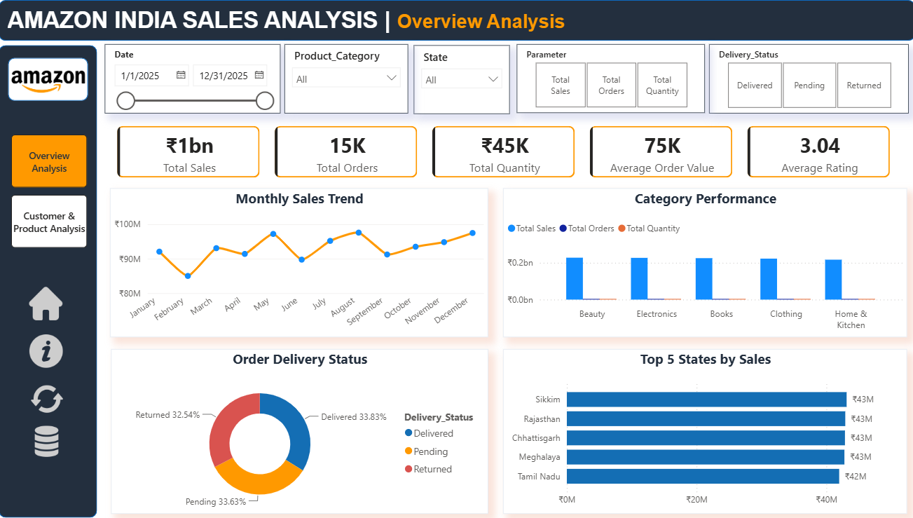
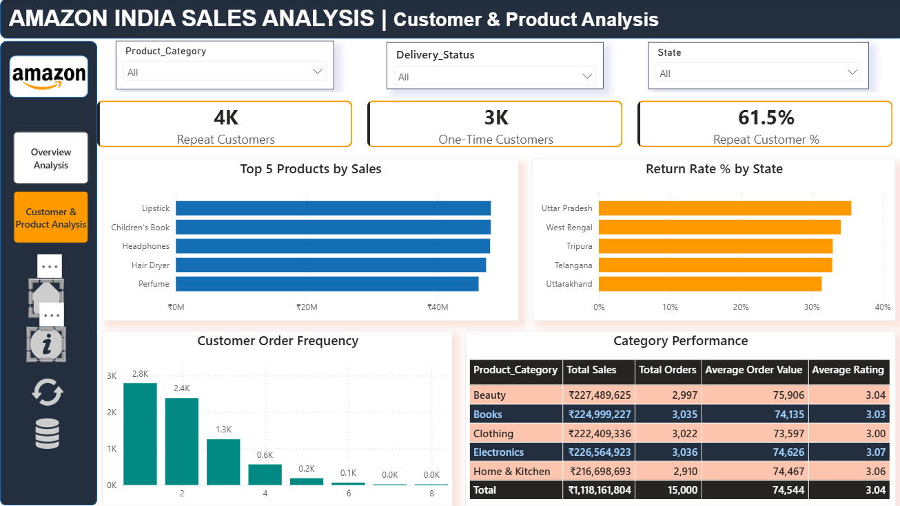

# Amazon India Sales 2025 Analysis — Python, MySQL & Power BI

An end-to-end data analytics project using **Python (Pandas), MySQL, and Power BI** to analyze sales performance, customer purchasing behavior, product categories, delivery status, and returns using an Amazon India sales dataset.

## Workflow

Raw CSV Dataset → Python/Pandas Analysis → MySQL Database → SQL Analysis → Power BI Dashboard

## Dataset

The Amazon India Sales 2025 dataset contains **15,000 sales records and 14 original columns**.

The dataset is used to explore sales trends, customer behavior, product performance, delivery status, payment methods, and customer ratings.

Key fields include:
- Order ID
- Order Date
- Customer ID
- Product
- Product Category
- Quantity
- Total Amount
- State
- Payment Method
- Delivery Status
- Customer Rating

## Python Data Analysis

The Jupyter Notebook uses **Python and Pandas** to:

- Import and inspect the dataset
- Convert and validate date fields
- Perform exploratory data analysis (EDA)
- Calculate total sales, total orders, and average order value
- Analyze monthly sales trends
- Compare product categories and state-wise sales
- Identify top-performing products
- Examine delivery status and returned orders
- Analyze payment methods and customer ratings
- Explore order quantities and customer purchasing patterns
- Generate charts for business insights

The Python analysis is available in the `02_Python/` folder.

## SQL Analysis

The dataset was imported into **MySQL**, containing 15,000 records.

SQL queries were used to analyze:

1. Total Sales and Order Count
2. Product Category Performance
3. Average Order Value
4. State-wise Sales Performance
5. Returned Orders and Delivery Status
6. Customer Purchasing Patterns
7. Payment Method Analysis

SQL techniques include:
- SELECT and WHERE
- GROUP BY and ORDER BY
- Aggregate functions: SUM, COUNT, AVG
- Calculated metrics and filtering

The SQL queries are stored in `03_SQL/amazon_sales_analysis.sql`.

## Power BI Dashboard

Two interactive Power BI dashboard pages were developed to visualize business performance.

### Page 1 — Customer & Product Analysis

The overview dashboard presents key business metrics and sales performance.

Key metrics:
- Total Sales
- Total Orders
- Total Quantity Sold
- Average Order Value
- Average Customer Rating

Visualizations include:
- Monthly Sales Trends
- Product Category Performance
- State-wise Sales Analysis
- Interactive Filters and Slicers

### Page 2 — Detailed Analysis

The detailed dashboard provides additional insights into products, customers, payments, and order performance.

Analysis includes:
- Top-performing Products
- Delivery and Return Status
- Payment Method Distribution
- Customer Rating Distribution
- Order Quantity Analysis
- Additional Product and Customer Insights

The dashboard includes interactive navigation and filtering features.

## Key Performance Indicators

| Metric | Value |
|---|---:|
| Total Sales | ₹1,118.16 Million |
| Total Orders | 15,000 |
| Total Quantity Sold | 44,770 |
| Average Order Value | ₹74,544.12 |
| Average Customer Rating | 3.04 / 5 |

## Key Business Insights

### 1. Product Category Performance

- **Beauty:** ₹227.49 Million
- **Electronics:** ₹226.57 Million
- **Books:** ₹225.00 Million
- **Clothing:** ₹222.41 Million
- **Home & Kitchen:** ₹216.70 Million

**Observation:** Beauty recorded the highest total sales among the five product categories.

### 2. Product Performance

Top products by total sales include:

- Lipstick — ₹48.16 Million
- Children's Book — ₹48.15 Million
- Headphones — ₹48.04 Million
- Hair Dryer — ₹47.43 Million
- Perfume — ₹46.28 Million

**Observation:** Sales were distributed across products from multiple categories rather than being concentrated in a single product type.

### 3. Delivery and Returns Analysis

| Delivery Status | Orders |
|---|---:|
| Delivered | 5,075 |
| Pending | 5,044 |
| Returned | 4,881 |

**Observation:** Returned orders accounted for approximately **32.54%** of all records, making returns an important area for further investigation.

### 4. Payment Method Analysis

| Payment Method | Orders |
|---|---:|
| Cash on Delivery | 3,827 |
| Credit Card | 3,800 |
| Debit Card | 3,727 |
| UPI | 3,646 |

**Observation:** Payment method usage was relatively balanced, with Cash on Delivery recording the highest number of transactions.

### 5. Customer Rating Analysis

The average customer rating was approximately **3.04 out of 5**.

**Observation:** Ratings were spread across the five rating levels, indicating mixed customer feedback within the dataset.

## Tools Used

| Tool | Purpose |
|---|---|
| Python | Data analysis and calculations |
| Pandas | Data manipulation and EDA |
| NumPy | Numerical operations |
| Matplotlib | Data visualization |
| Jupyter Notebook | Python analysis workflow |
| MySQL | Database storage and SQL analysis |
| Power BI | Interactive dashboard development |
| DAX | KPI calculations and dashboard measures |
| GitHub | Project documentation and version control |

## Repository Structure

    Amazon-India-Sales-Analysis/
    ├── README.md
    ├── 01_Dataset/
    │   ├── README.md
    │   └── [Amazon Sales Dataset.csv]
    ├── 02_Python/
    │   ├── README.md
    │   └── [Amazon Analysis.ipynb]
    ├── 03_SQL/
    │   ├── README.md
    │   └── amazon_sales_analysis.sql
    └── 04_PowerBI/
        ├── README.md
        ├── Amazon_India_Sales_Dashboard.pbix
        ├── Dashboard_Overview.png
        └── Dashboard_Customer&Product_Analysis.png

## Key Learning Outcomes

- Working with structured sales datasets
- Data inspection and exploratory data analysis
- Data manipulation using Pandas
- Date conversion and monthly trend analysis
- SQL database creation and data importing
- SQL aggregation, grouping, and filtering
- Business KPI calculation
- Sales and product performance analysis
- Customer behavior and returns analysis
- Data visualization using Python
- Interactive dashboard development using Power BI
- DAX measures and dashboard navigation
- Translating data into business insights

## Project Note

This project was developed as a **data analytics learning and portfolio project** to demonstrate an end-to-end analytical workflow using Python, MySQL, and Power BI.

The analysis focuses on understanding business performance through sales metrics, customer behavior, product trends, and order-related insights.

## Dashboard Preview

### Page 1 — Overview Analysis

### Page 2 — Customer & Product Analysis

